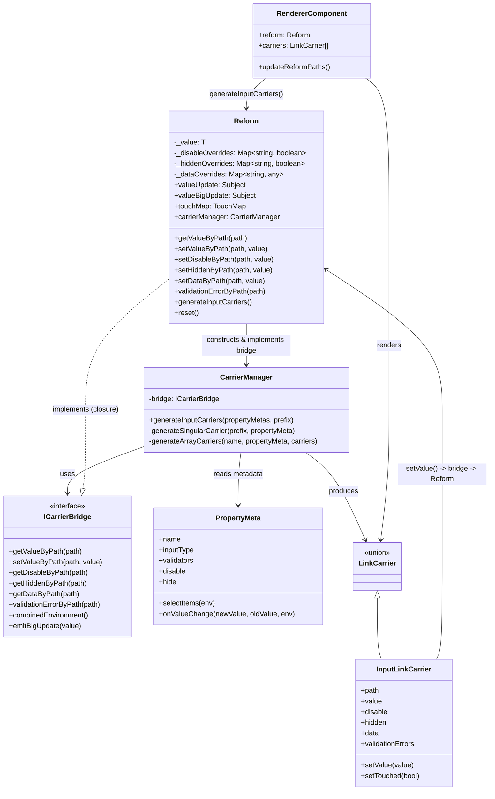

# Reform Çalışma Akışı

Bu doküman Minky `Reform` çekirdeğinin veri tutma, carrier üretimi ve render akışını özetler. Kod değiştikçe bu dokümanı güncel tutun; davranışsal veya güvenlikle ilgili detaylarda kaynağı doğrulayın.

## Genel Bakış

- `Reform<T>` form verisini (`_value`), doğrulama/touch durumunu ve path bazlı dinamik override'ları (`disable`, `hidden`, `data`) tutan tek kaynak (single source of truth).
- `PropertyMeta` (dekoratörle tanımlanan alan metadata'sı) statik yapılandırmayı taşır: input tipi, validator, `selectItems`, `onValueChange` vb.
- `CarrierManager`, `PropertyMeta[]` ile `Reform`'un o anki durumunu birleştirip renderer'ların tükettiği `LinkCarrier[]` (input/action/group) listesini üretir.
- `ICarrierBridge`, `CarrierManager`'ın `Reform`'a yalnızca ihtiyaç duyduğu yüzeyle (value/validation/touch/disable/hidden/data okuma-yazma) eriştiği daraltılmış arayüzdür; `CarrierManager` `Reform`'un iç yapısını bilmez.
- Renderer bileşenleri (`ReformNgxPrimeComponent`, `MinkyReformComponent`) `Reform.generateInputCarriers()` çağırıp carrier'ları template'e bağlar; kullanıcı etkileşimi carrier'ın `setValue`/`setTouched` gibi fonksiyonları üzerinden tekrar `Reform`'a yazılır.

## Bileşenler Arası İlişki



`Reform`, `CarrierManager`'ı kurarken `ICarrierBridge` sözleşmesini karşılayan bir closure nesnesi verir (ayrı bir sınıf değildir); böylece `CarrierManager` yalnızca bridge arayüzüne bağımlı kalır ve `Reform`'un iç alanlarına doğrudan erişmez.

## Carrier Üretim Akışı

`Reform.generateInputCarriers()` çağrıldığında (renderer'ın `updateReformPaths()` metodundan tetiklenir):

```mermaid
sequenceDiagram
    participant Renderer as RendererComponent
    participant Reform
    participant CM as CarrierManager
    participant Bridge as "ICarrierBridge (Reform closure)"
    participant Meta as PropertyMeta

    Renderer->>Reform: generateInputCarriers()
    Reform->>CM: generateInputCarriers(propertyMetas)
    loop her PropertyMeta için
        CM->>Meta: hide? subObjectKey? inputType == array?
        alt array
            CM->>CM: generateArrayCarriers(...)
        else sub-object
            CM->>CM: generateSubObjectCarrier(...)
        else singular input
            CM->>Bridge: getValueByPath(path)
            CM->>Bridge: getDisableByPath(path)
            CM->>Bridge: getHiddenByPath(path)
            CM->>Bridge: getDataByPath(path)
            CM->>Bridge: validationErrorByPath(path)
            CM->>Bridge: touchMap().getPathStatus(path)
            CM->>Bridge: getFeeder(path)
            CM-->>CM: InputLinkCarrier üret (setValue/setTouched fonksiyonlarıyla)
        end
    end
    CM-->>Reform: LinkCarrier[]
    Reform-->>Renderer: LinkCarrier[]
    Renderer->>Renderer: carriers = ...; changeDetector.detectChanges()
```

Renderer, `afterViewInit` sonrası ve `Reform.valueBigUpdate` her yayın yaptığında `updateReformPaths()`'i tekrar çağırır; bu nedenle carrier listesi büyük güncellemelerde (reset, patchValue, array ekleme/çıkarma, `onValueChange` tetiklediği durumlar) yeniden kurulur.

## Kullanıcı Girdisi ve Dinamik Durum Akışı

`InputLinkCarrier.setValue(value)` çağrıldığında (kullanıcı bir alanı değiştirdiğinde):

```mermaid
sequenceDiagram
    participant User as "Kullanıcı (template)"
    participant Carrier as InputLinkCarrier
    participant CM as CarrierManager
    participant Bridge as "ICarrierBridge (Reform)"
    participant Meta as "PropertyMeta.onValueChange"
    participant Reform
    participant Renderer as RendererComponent

    User->>Carrier: setValue(newValue)
    Carrier->>CM: (closure) çalışır
    CM->>Meta: onValueChange(newValue, oldValue, combinedEnvironment)
    Meta-->>CM: overrideValue veya undefined
    Note over Meta: onValueChange içinde<br/>environment.state.setDisabled/setHidden/setData<br/>çağrılabilir (başka path'leri etkiler)
    CM->>Bridge: setValueByPath(path, overrideValue ?? newValue)
    Bridge->>Reform: this.value[...] = value; valueUpdate.next(value)
    CM->>Bridge: getValueByPath(path) (son değeri al)
    CM->>Bridge: validationErrorByPath(path)
    alt onValueChange tanımlıysa
        CM->>Bridge: emitBigUpdate(value)
        Bridge->>Reform: valueBigUpdate.next(value)
        Reform-->>Renderer: valueBigUpdate aboneliği tetiklenir
        Renderer->>Reform: generateInputCarriers() (yeniden kurulum)
    end
```

`onValueChange` yalnızca değer döndürme sözleşmesini korur; başka bir alanın `disable`/`hidden`/`data` durumunu değiştirmek için `combinedEnvironment().state` üzerinden path bazlı setter'lar kullanılır (`environment.state.setDisabled(path, bool)`, `setHidden(path, bool)`, `setData(path, any)`). Bu değerler `Reform` içinde `_disableOverrides` / `_hiddenOverrides` / `_dataOverrides` map'lerinde tutulur ve `reset()` ile temizlenir.

## Doğrulama ve Görünürlük Kuralları

- `Reform.validationErrorByPath(path)`, path `disable` veya `hidden` (statik `PropertyMeta.disable`/`hide` ya da dinamik override) ise doğrulamayı atlar ve boş dizi döner.
- `allValidationErrors()` tüm meta path'lerini gezip aynı kuralı uygular; bu nedenle dinamik olarak gizlenen/pasifleştirilen alanlar formun genel geçerliliğini bloklamaz.
- `hidden` olan carrier'lar `CarrierManager` tarafından hâlâ üretilir (listeden çıkarılmaz); renderer template'leri `*ngIf="... && !carrier.hidden"` ile bunları DOM'da göstermez. Statik `PropertyMeta.hide` ise carrier'ı üretim aşamasında tamamen atlar.

## Path Sözleşmesi

- Path'ler nokta ile ayrılmış alan adlarıdır (`serie.name`, `friends.0.name`). `Reform.getValueByPath`/`setValueByPath`/`getPropertyMeta` aynı path çözümleme mantığını (array/sub-object aşamalarını) paylaşır.
- Dinamik override map'leri (`disable`/`hidden`/`data`) da aynı path string'i anahtar olarak kullanır; bu nedenle bir alanın kendi callback'i içinde başka bir path'i (kardeş, üst veya nested) hedefleyebilir.
